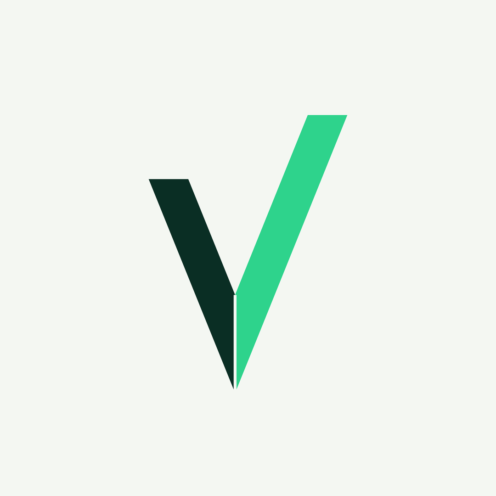
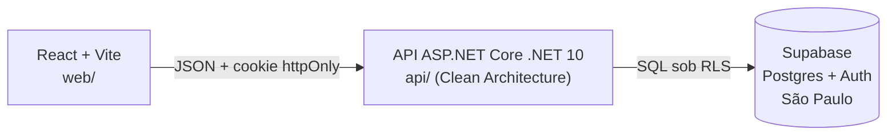

<div align="center">

<picture>
  <source media="(prefers-color-scheme: dark)" srcset="web/public/brand/velos-escuro.png">
  
</picture>

# Velos Wallet

**Seu dinheiro na direção certa.**

Gestão financeira pessoal para quem mora no Brasil: todas as suas contas num lugar só, para onde o dinheiro está indo e quanto falta para a sua meta.


</div>

---

## A ideia

Muita gente no Brasil não consegue responder três perguntas simples sobre o próprio dinheiro:

1. **Quanto eu tenho agora?** O saldo fica espalhado entre conta corrente, poupança, dinheiro vivo e cartão.
2. **Para onde o meu dinheiro está indo?** Sem categorias, o fim do mês chega sem explicação.
3. **Estou chegando perto do que quero?** A viagem, a reserva de emergência ou a compra grande ficam só na cabeça, sem um número.

E isso não é um problema de nicho:

| | |
|---|---|
| **82%** | das famílias brasileiras estão endividadas, recorde da série (CNC/Peic, jul/2026) |
| **31%** | dos brasileiros não têm nenhuma reserva de emergência (Anbima/Datafolha, 2026) |
| **48%** | controlam o dinheiro com anotação ou planilha, e **16%** não controlam nada (Lina Open X/MindMiners, 2026) |

O **Velos Wallet** responde as três perguntas num painel simples e visual, que você instala no celular e no PC direto do navegador.

## Por que o Velos

- 🏦 **Todas as contas num lugar só.** O app do banco só mostra o próprio banco.
- 📲 **Sem loja de apps.** É um PWA: instala direto do navegador, no celular e no computador.
- 🔒 **Privado por padrão.** Cada pessoa só enxerga os próprios dados. A regra é garantida no servidor e no banco, não só na tela.
- ✨ **Simples de verdade.** Lançar uma despesa leva no máximo 3 toques. Concorrentes cobram de R$ 19,90 a R$ 35 por mês por recursos que a maioria não usa.

## O que o MVP vai entregar

| | Funcionalidade | Estado |
|---|---|---|
| 🌐 | Página inicial pública | ✅ Pronto |
| 🔐 | Cadastro e login (email e senha, conta Google) | 🟡 Em andamento |
| 💳 | Contas: corrente, poupança, dinheiro e cartão de crédito | ⬜ Pendente |
| 🏷️ | Categorias com cor e ícone | ⬜ Pendente |
| 💸 | Receitas, despesas e transferências entre contas | ⬜ Pendente |
| 📊 | Painel: saldo total, receitas × despesas do mês e gastos por categoria | ⬜ Pendente |
| 🎯 | Metas com valor-alvo, prazo e aportes | ⬜ Pendente |
| 📱 | PWA instalável | ⬜ Pendente |

O andamento detalhado fica no [ROADMAP](docs/ROADMAP.md).

## Como foi construído



**API** (`api/`)
- ASP.NET Core **.NET 10** em Clean Architecture: `Domain` → `Application` → `Infrastructure` → `Api`
- FluentValidation, EF Core + Npgsql e testes com xUnit
- Toda rota é privada por padrão. Rota pública precisa de `[AllowAnonymous]` explícito.

**Front** (`web/`)
- React 19 + Vite + TypeScript strict
- Tailwind CSS v4 + shadcn/ui sobre `@base-ui/react`
- React Hook Form + Zod, TanStack Query e date-fns em `ptBR`

**Banco** (`supabase/`)
- Supabase (Postgres 17 + Auth) na região **sa-east-1 (São Paulo)**
- Schema versionado em migrations SQL e aplicado com o Supabase CLI

### Decisões que fazem diferença

- **Dinheiro em centavos inteiros.** Nada de `float` ou `decimal`: `bigint` no banco, `long` no C# e `number` inteiro no TypeScript. Nenhum centavo some por arredondamento.
- **Segurança em camadas.** O front nunca fala com o banco. A sessão fica num cookie `httpOnly`, nunca no `localStorage`. A API roda cada consulta com o usuário autenticado e a **Row Level Security** do Postgres impede ler dados de outra pessoa, mesmo que a API erre.
- **Somas no SQL.** Saldos e totais saem de views do banco, não de código C# ou JavaScript.
- **Acessível nos dois temas.** Todo par de texto e fundo passa de 4,5:1 (WCAG AA), no claro e no escuro. Receita e despesa nunca dependem só da cor: sempre levam sinal `+`/`-` ou ícone.
- **Mobile-first.** Cada tela é pensada primeiro para 375 px de largura.

Cada decisão importante tem um registro em [docs/adr/](docs/adr/).

## Rodando localmente

### Pré-requisitos

- [.NET 10 SDK](https://dotnet.microsoft.com/download)
- [Node.js](https://nodejs.org/) 20 ou mais recente
- Um projeto no [Supabase](https://supabase.com/)

### 1. Clone e instale

```bash
git clone https://github.com/pdfreitass/Velos-Wallet.git
cd Velos-Wallet
npm install
npm install --prefix web
```

### 2. Configure a API

A connection string do banco fica fora do repositório, nos *user secrets* do .NET:

```bash
dotnet user-secrets set "ConnectionStrings:Velos" "<sua connection string>" --project api/src/Velos.Api
```

A URL e a chave publicável do Supabase ficam em `api/src/Velos.Api/appsettings.json`.

### 3. Rode (um terminal para cada)

```bash
dotnet run --project api/src/Velos.Api   # API em http://localhost:5080
npm run dev --prefix web                 # front em http://localhost:3000
```

Abra **http://localhost:3000**. O front repassa as chamadas para a API.

### Verificações

```bash
dotnet build api && dotnet test api
npm run typecheck --prefix web
npm run lint --prefix web
npm run build --prefix web
```

## Estrutura do projeto

```
api/          API ASP.NET Core (Domain, Application, Infrastructure, Api) e testes
web/          SPA React + Vite
supabase/     migrations SQL e modelos de email
docs/         visão, arquitetura, roadmap, ADRs e specs
```

## Como o projeto é desenvolvido

O Velos segue **Spec-Driven Development**: cada funcionalidade começa por uma spec com critérios de aceite, depois vem um plano técnico e, por fim, uma lista de tarefas pequenas e verificáveis. Tudo isso fica em [docs/specs/](docs/specs/).

| Documento | Conteúdo |
|---|---|
| [VISAO.md](docs/VISAO.md) | Problema, público, objetivos e o que fica fora do escopo |
| [ARQUITETURA.md](docs/ARQUITETURA.md) | Stack, pastas, fluxo de dados e segurança |
| [ROADMAP.md](docs/ROADMAP.md) | Onde o projeto está e o que vem a seguir |
| [CHANGELOG.md](docs/CHANGELOG.md) | O que já foi entregue |
| [adr/](docs/adr/) | O porquê de cada decisão |

## Autor

Feito por **Pedro Freitas** · [GitHub](https://github.com/pdfreitass) · Instagram [@veloswallet](https://instagram.com/veloswallet)
